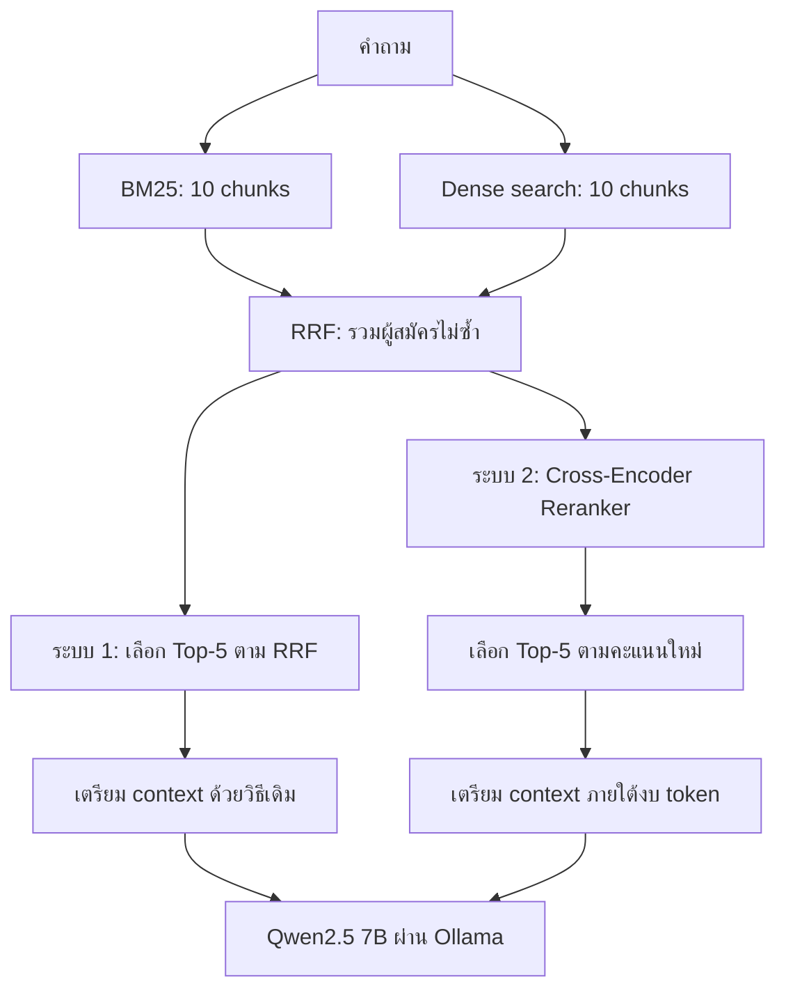

# เปรียบเทียบระบบ RAG ก่อนและหลังเพิ่ม Reranking

**ข้อค้นพบหลัก:** ระบบ (2) ช่วยจัดเอกสารที่ตอบคำถามให้ขึ้นมาอยู่ในอันดับที่เหมาะสมขึ้น โดยเห็นชัดในคำถามเรื่องการป้องกันและการติดเชื้อหลังได้รับวัคซีน แต่คุณภาพคำตอบไม่ได้ดีขึ้นทุกข้อ และส่วนควบคุม token ยังมีข้อผิดพลาดที่ต้องแก้ก่อนประเมินผลด้านนี้

## 1. ระบบ (1) และ (2) คืออะไร

| ระบบ | โปรแกรมที่ใช้เปรียบเทียบ | ผลการรัน |
|---|---|---|
| **(1) ก่อนเพิ่ม reranking** | [onlysearchAuthenticRAGbak.py](onlysearchAuthenticRAGbak.py) | [authentic_rag_search_resultsbak.json](authentic_rag_search_resultsbak.json) |
| **(2) หลังเพิ่ม reranking และการจัดการ context** | [onlysearchAuthenticRAG.py](onlysearchAuthenticRAG.py) | [authentic_rag_search_results.json](authentic_rag_search_results.json) |

ทั้งสองโปรแกรมค้นหาจาก OpenSearch indices ชื่อ `anthropic-vector-index` และ `anthropic-bm25-index` ใช้ embedding `BAAI/bge-m3` และตั้งค่าโมเดลสร้างคำตอบเป็น **Qwen2.5 7B ผ่าน Ollama** เหมือนกัน

การใช้โมเดลเดียวกันอ้างอิงจากโค้ดทั้งสองไฟล์ ส่วน JSON หลังปรับมี `generation.model="qwen2.5:7b"` ยืนยันเพิ่มเติม แต่ JSON ก่อนปรับไม่ได้บันทึกชื่อโมเดลหรือ usage ไว้

### ไฟล์อื่นในโปรเจกต์

| ไฟล์ | หน้าที่และสถานะปัจจุบัน |
|---|---|
| [authenticRAGbak.py](authenticRAGbak.py) | โหลด Markdown แบ่ง chunks สร้างบริบทและ embedding นำเข้า OpenSearch และมีตัวอย่างค้นหาแบบ RRF |
| [authenticRAG.py](authenticRAG.py) | มีขั้นตอนนำเข้าข้อมูลเช่นเดียวกัน และเพิ่ม reranker ในขั้นค้นหา |
| `onlysearchAuthenticRAGbak.py` | ค้นหาและตอบจาก index ที่มีอยู่ ไม่ได้นำเข้าเอกสารใหม่ |
| `onlysearchAuthenticRAG.py` | ค้นหาจาก index เดิม เพิ่ม reranking และเตรียม context ภายใต้งบ token |
| ไฟล์ JSON สองไฟล์ | เก็บคำถาม คำตอบ และ 5 chunks ที่เลือก โดยฝั่งหลังปรับเก็บข้อมูล generation เพิ่ม |

> **โปรเจกต์ยังไม่ได้เป็น local ทุกส่วน:** ไฟล์ `authenticRAG.py` และ `authenticRAGbak.py` ยังเรียก Qwen2.5 72B ผ่าน OpenRouter สำหรับสร้างบริบทตอนนำเข้าและสร้างคำตอบในตัวอย่างของไฟล์นั้น ส่วนการเปรียบเทียบ JSON ใน README นี้ใช้โปรแกรม `onlysearch...` ที่เปลี่ยนมาเรียก Ollama แล้ว

## 2. เหตุผลที่เปลี่ยนไปใช้ Local Model

ระหว่างการทดลองก่อนย้ายไป local พบ error `402` จาก OpenRouter เช่น:

```text
Prompt tokens limit exceeded: 9548 > 3793
limit_source: openrouter_credits
```

ตัวเลขนี้บอกว่าคำขอมีต้นทุนเกินเครดิตหรืองบคำขอที่รองรับได้ขณะนั้น **ไม่ใช่เพดาน context window สูงสุดของ Qwen** จากประวัติการทดลองยังพบยอดเครดิตบัญชีติดลบ แม้ API key ใหม่จะมีวงเงินรายวันเหลืออยู่ เพราะวงเงินของ key เป็นเพดานใช้จ่าย ไม่ใช่เครดิตที่เติมให้บัญชี [ข้อจำกัด OpenRouter](https://openrouter.ai/docs/api_reference/limits)

อีกปัจจัยคือฟังก์ชันเดิมประมาณ tokens จากจำนวนส่วนที่คั่นด้วยช่องว่าง ซึ่งไม่แม่นสำหรับภาษาไทย จึงส่ง prompt ที่ยาวกว่าที่ประมาณไว้ การรอรีเซ็ตวงเงินหรือสร้าง key ใหม่ไม่ได้เพิ่มยอดเครดิตบัญชี

จึงเปลี่ยน **ทั้งระบบ (1) และ (2)** มาใช้ `qwen2.5:7b` ผ่าน Ollama ที่ `http://127.0.0.1:11434/api/chat` เพื่อทดสอบซ้ำโดยไม่พึ่งเครดิต OpenRouter รุ่น 7B เหมาะกับเครื่องทดลอง RAM ประมาณ 16 GB และ RTX 3060 VRAM 12 GB มากกว่ารุ่น 72B โดยไฟล์โมเดลบีบอัดบน Ollama มีขนาดประมาณ 4.7 GB และ 47 GB ตามลำดับ [Qwen2.5 7B](https://ollama.com/library/qwen2.5:7b), [Qwen2.5 72B](https://ollama.com/library/qwen2.5:72b)

ค่าหลักในคำขอของทั้งสองไฟล์ตรงกัน:

```python
"model": "qwen2.5:7b",
"stream": False,
"options": {
    "num_ctx": self.ollama_num_ctx,  # ค่าเริ่มต้น 16,384 tokens
    "num_predict": max_tokens,      # ตอนสร้างคำตอบตั้งไว้ 1,000 tokens
    "temperature": temperature,     # ตอนสร้างคำตอบใช้ 0.6
}
```

Local ไม่ได้มี tokens ไม่จำกัด: prompt และคำตอบยังต้องอยู่ใน context window ที่จัดสรร และ context ยาวขึ้นใช้หน่วยความจำเพิ่ม การย้ายมา local แก้การพึ่งพาเครดิต แต่ไม่แก้การนับ token ผิดหรือคำตอบชนเพดาน output โดยอัตโนมัติ [API Ollama](https://docs.ollama.com/api/chat), [Context length](https://docs.ollama.com/context-length)

> การเปลี่ยน **72B เป็น 7B ถือเป็นการเปลี่ยนโมเดลสร้างคำตอบ** แม้อยู่ในตระกูลเดียวกัน จึงรายงานการย้ายนี้เป็นการเตรียมสภาพแวดล้อมสำหรับทั้งสองฝั่ง แล้วเปรียบเทียบ RAG โดยคง 7B ตัวเดียวกันระหว่าง (1) กับ (2) หากโจทย์กำหนดให้คง 72B เดิมอย่างเคร่งครัด การทดลอง local นี้ยังไม่ตรงเงื่อนไขนั้น และไม่ควรอ้างว่า 7B กับ 72B ให้คุณภาพเท่ากัน

## 3. ต่างกันตรงไหน

### 3.1 ส่วนที่ใช้เหมือนกัน

- **Chunking:** ใช้ chunks ที่มีอยู่ใน index เดิม ไม่ได้แบ่งเอกสารใหม่สำหรับแต่ละรอบค้นหา ไฟล์นำเข้าตั้งค่า `MarkdownNodeParser(chunk_size=256)` เหมือนกัน แต่ค่านี้เพียงอย่างเดียวไม่ได้พิสูจน์ขนาดจริงของทุก chunk
- **Embedding:** `SentenceTransformer('BAAI/bge-m3')` สร้าง embedding ของคำถาม
- **Sparse search:** BM25 ค้นใน `content` และ `contextualized_content` ด้วย `multi_match`
- **Dense search:** ค้นเวกเตอร์ด้วย `knn` ใน OpenSearch
- **Fusion:** รวมอันดับด้วย RRF ค่า `rrf_k=60`
- **จำนวนผู้สมัคร:** เมื่อ `k=5` ดึง 10 chunks ต่อวิธี รวมได้สูงสุด 20 chunks ที่ไม่ซ้ำ แล้วเลือก 5 ชิ้นสุดท้าย
- **LLM สร้างคำตอบ:** Qwen2.5 7B ผ่าน Ollama ใช้ prompt รูปแบบเดียวกันและเพดาน output 1,000 tokens

### 3.2 ส่วนที่เปลี่ยน

| ประเด็น | (1) ก่อนปรับ | (2) หลังปรับ |
|---|---|---|
| อันดับสุดท้าย | เลือก Top-5 ตาม RRF | ให้ Cross-Encoder จัดผู้สมัครหลัง RRF ใหม่ก่อนเลือก Top-5 |
| โมเดลให้คะแนนเพิ่มเติม | ไม่มี | `BAAI/bge-reranker-v2-m3` |
| คะแนนใน `results[].score` | RRF score | Reranker score |
| การเตรียม context | ประมาณ tokens จากช่องว่าง | เพิ่มการนับด้วย tokenizer และตรวจ prompt ทั้งชุด |
| งบ prompt | ใช้ค่าประมาณของ context 4,000 tokens | ตั้งค่าเริ่มต้น 14,000 tokens เผื่อ 256 tokens และสำรองพื้นที่คำตอบ |
| การเก็บข้อมูล | question, answer, results | เพิ่ม use_reranker, generation, usage, finish_reason และ context_sent |

การเพิ่ม reranking อยู่ในขอบเขต **reranking** โดยตรง ส่วนการเตรียม context ภายใต้งบ token อยู่ในกลุ่ม **“อื่น ๆ” ของ RAG** เพราะปรับข้อมูลก่อนส่งให้ LLM การเติมเครดิตหรือเปลี่ยนวงเงินบัญชีเป็นการตั้งค่าบริการ ไม่ใช่การปรับอัลกอริทึม RAG



## 4. โค้ดก่อนและหลัง Rerank พร้อมคำอธิบาย

ตัวอย่างต่อไปนี้คัดจากโค้ดปัจจุบัน เป็นส่วนของคลาส `AuthenticSearchRAG` จึงไม่ใช่โปรแกรม standalone ต้องใช้ร่วมกับเมธอดอื่นในไฟล์เต็ม

### 4.1 ก่อนปรับ: เลือก Top-k จาก RRF ทันที

จาก `onlysearchAuthenticRAGbak.py`:

```python
def hybrid_search(self, query, k=5, rrf_k=60):
    """ค้นหาแบบ hybrid ด้วย RRF ที่รวมผลจาก sparse และ dense search (เหมือนตัวอย่าง)"""
    # ค้นหาด้วย BM25 (sparse)
    sparse_results = self.sparse_search(query, k=k*2)
    print(f"\nSparse search found {len(sparse_results)} results")

    # ค้นหาด้วย vector similarity (dense)
    dense_results = self.dense_search(query, k=k*2)
    print(f"Dense search found {len(dense_results)} results")

    # ใช้ RRF ผสมผลลัพธ์
    rankings = [sparse_results, dense_results]
    fused_results = self.rrf_fusion(rankings, k=rrf_k)
    print(f"RRF fusion returned {len(fused_results)} results")

    return fused_results[:k]
```

1. `sparse_search(query, k=k*2)` ดึงผู้สมัครจาก BM25
2. `dense_search(query, k=k*2)` ดึงผู้สมัครจากเวกเตอร์
3. `rrf_fusion()` รวมอันดับและรวมคะแนนของ chunk ที่มี ID เดียวกัน
4. `fused_results[:k]` เลือกตาม RRF ทันที โดยไม่ประเมินคู่คำถาม–ข้อความเพิ่มเติม

### 4.2 RRF ที่ทั้งสองระบบใช้เหมือนกัน

```python
def rrf_fusion(self, rankings, k=60):
    """ผสมผลลัพธ์การค้นหาด้วย Reciprocal Rank Fusion (เหมือนในตัวอย่าง)"""
    fused_scores = {}
    doc_sources = {}

    for ranker_id, results in enumerate(rankings):
        for rank, (doc_id, score, source) in enumerate(results):
            if doc_id not in fused_scores:
                fused_scores[doc_id] = 0
                doc_sources[doc_id] = source

            # RRF formula: 1 / (k + rank)
            fused_scores[doc_id] += 1.0 / (k + rank)

    # เรียงลำดับตาม RRF score
    sorted_results = sorted(fused_scores.items(), key=lambda x: x[1], reverse=True)
    return [(doc_id, score, doc_sources[doc_id]) for doc_id, score in sorted_results]
```

ผลค้นหาแต่ละชิ้นมีรูปแบบ `(doc_id, score, source)` ฟังก์ชันใช้ **อันดับ** มาคิดส่วนร่วม `1 / (k + rank)` แทนการบวกคะแนน BM25 กับ vector โดยตรง เพราะคะแนนสองระบบมีสเกลต่างกัน

`enumerate(results)` ในไฟล์จริงเริ่มที่ 0 ดังนั้นอันดับแรกมีส่วนร่วม `1/60 ≈ 0.01667` เมื่อ `k=60` ถ้าพบ chunk ในทั้งสองรายการก็สะสมส่วนร่วมจากทั้งสองรายการ ทั้งสองเวอร์ชันใช้วิธีนี้เหมือนกัน

`k` ในฟังก์ชัน RRF เป็นค่าคงที่ในสูตร ส่วน `k` ใน `hybrid_search()` เป็นจำนวนผลลัพธ์สุดท้าย เป็นพารามิเตอร์คนละหน้าที่

### 4.3 หลังปรับ: โหลด Cross-Encoder ครั้งเดียว

```python
from sentence_transformers import SentenceTransformer, CrossEncoder

# ส่วนนี้อยู่ใน __init__ ของ AuthenticSearchRAG
self.use_reranker = os.environ.get("RAG_USE_RERANKER", "1") != "0"
self.reranker = (
    CrossEncoder("BAAI/bge-reranker-v2-m3", max_length=512)
    if self.use_reranker else None
)
```

- โมเดลนี้ใช้ **ให้คะแนนความเกี่ยวข้อง** ไม่ได้สร้างคำตอบสุดท้าย จึงเป็นการเพิ่ม reranker โดยไม่เปลี่ยน LLM ระหว่างสองระบบ
- โหลดใน `__init__` เพื่อใช้ซ้ำหลายคำถาม
- `RAG_USE_RERANKER=1` เปิด และ `0` ปิด
- `max_length=512` จำกัด tokens ของคู่คำถาม–ข้อความเฉพาะตอนให้คะแนน ข้อความยาวอาจถูกตัดในขั้นนี้ แต่ `source` ยังเก็บเนื้อหาเต็ม จึงไม่ได้จำกัดความยาว context ที่ส่งให้ LLM

### 4.4 หลังปรับ: ให้คะแนนผู้สมัครและเรียงใหม่

```python
def rerank(self, query, candidates, top_k=5):
    """Reorder the original retrieval candidates with a cross-encoder."""
    if not candidates:
        return []

    if self.reranker is None:
        raise ValueError("Reranker is disabled; set RAG_USE_RERANKER=1 before starting")

    pairs = [
        (query, source.get("content", ""))
        for _, _, source in candidates
    ]
    scores = np.asarray(
        self.reranker.predict(
            pairs,
            batch_size=16,
            show_progress_bar=False
        )
    ).reshape(-1)

    if len(scores) != len(candidates):
        raise ValueError("Reranker returned an unexpected number of scores")
    if not np.isfinite(scores).all():
        raise ValueError("Reranker returned non-finite scores")

    ranked = [
        (doc_id, float(score), source, rrf_score)
        for (doc_id, rrf_score, source), score
        in zip(candidates, scores)
    ]
    ranked.sort(key=lambda item: (item[1], item[3]), reverse=True)
    return [
        (doc_id, score, source)
        for doc_id, score, source, _ in ranked[:top_k]
    ]
```

| ส่วนของโค้ด | หน้าที่ |
|---|---|
| `if not candidates` | คืนรายการว่างเมื่อไม่มีผู้สมัคร |
| `if self.reranker is None` | ป้องกันการเรียกให้คะแนนขณะไม่ได้โหลดโมเดล |
| `(query, source.get("content", ""))` | สร้างคู่คำถามกับเนื้อหา chunk ให้โมเดลอ่านร่วมกัน |
| `predict(..., batch_size=16)` | ประเมินคู่ข้อมูลเป็นกลุ่ม และคืนคะแนนแต่ละคู่ |
| `np.asarray(...).reshape(-1)` | จัดคะแนนเป็น array หนึ่งมิติสำหรับจับคู่กับผู้สมัคร |
| ตรวจจำนวนคะแนนและ `np.isfinite()` | ป้องกันจำนวนคะแนนผิด หรือมีค่าที่ใช้จัดอันดับไม่ได้ |
| `zip(candidates, scores)` | ผูกคะแนนใหม่กับเอกสารเดิม และเก็บ RRF score ไว้ชั่วคราว |
| `key=lambda item: (item[1], item[3])` | เรียงจาก reranker score มากไปน้อย หากเท่ากันใช้ RRF score ตัดสิน |
| `ranked[:top_k]` | เลือกเอกสารหลังเรียงใหม่ตามจำนวนที่ต้องการ |

ผลลัพธ์ยังเป็น `(doc_id, score, source)` แต่ `score` กลายเป็นคะแนน reranker ทำให้ขั้นตอนสร้าง context ใช้รูปแบบผลเดิมต่อได้ คะแนนใกล้ 1 ไม่ได้หมายถึงคำตอบถูกต้องใกล้ 100%

### 4.5 หลังปรับ: แทรก Reranking ก่อนตัดเหลือ Top-k

```python
def hybrid_search(self, query, k=5, rrf_k=60, use_reranker=None):
    """ค้นหาแบบ hybrid ด้วย RRF ที่รวมผลจาก sparse และ dense search (เหมือนตัวอย่าง)"""
    # ค้นหาด้วย BM25 (sparse)
    sparse_results = self.sparse_search(query, k=k*2)
    print(f"\nSparse search found {len(sparse_results)} results")

    # ค้นหาด้วย vector similarity (dense)
    dense_results = self.dense_search(query, k=k*2)
    print(f"Dense search found {len(dense_results)} results")

    # ใช้ RRF ผสมผลลัพธ์
    rankings = [sparse_results, dense_results]
    fused_results = self.rrf_fusion(rankings, k=rrf_k)
    print(f"RRF fusion returned {len(fused_results)} results")

    # Rerank the SAME fused candidate pool as the bak version.
    # With k=5: BM25 top-10 + dense top-10, up to 20 unique chunks.
    if use_reranker is None:
        use_reranker = self.use_reranker
    if use_reranker:
        return self.rerank(query, fused_results, top_k=k)

    return fused_results[:k]
```

จุดเปลี่ยนหลักคือ:

```python
# ก่อน: เลือกตามอันดับ RRF
return fused_results[:k]

# หลัง: ประเมินผู้สมัครทั้งหมด แล้วค่อยเลือก
return self.rerank(query, fused_results, top_k=k)
```

การส่งผู้สมัครทั้งหมดเข้า reranker ก่อนเลือกทำให้เอกสารที่เดิมอยู่นอก Top-5 ขึ้นมาแทนได้ หากเลือก 5 ชิ้นก่อน rerank จะเปลี่ยนได้เพียงลำดับภายใน 5 ชิ้นนั้น และ reranker ไม่สามารถค้นเอกสารใหม่ที่อยู่นอกรายการผู้สมัครเองได้

`use_reranker=None` ใช้ค่าที่ตั้งไว้ใน `self.use_reranker` ถ้าปิด reranking จะได้อันดับ RRF แต่ยังผ่านวิธีจัดการ context ของระบบ (2) จึงไม่ได้เหมือนระบบ (1) ทุกขั้นตอน

## 5. การจัดการ Context และ Token: โค้ดต่างกันอย่างไร

### 5.1 วิธีเดิม

```python
def truncate_context(self, context, max_tokens=4000):
    """ย่อ context ให้มีขนาดไม่เกิน max_tokens"""
    words = context.split()
    estimated_tokens = len(words) * 1.3

    if estimated_tokens <= max_tokens:
        return context

    target_words = int(max_tokens / 1.3)
    truncated_context = " ".join(words[:target_words])
    return truncated_context + " ...(truncated)"
```

ภาษาไทยอาจมีข้อความยาวโดยไม่มีช่องว่าง ทำให้ `len(context.split())` ต่ำกว่าจำนวน tokens จริง การตั้งชื่อพารามิเตอร์ `max_tokens=4000` จึงไม่ได้รับประกันว่า context ไม่เกิน 4,000 tokens

### 5.2 วิธีใหม่ที่ตั้งใจใช้

ระบบ (2) โหลด tokenizer `Qwen/Qwen2.5-7B-Instruct` แล้วเรียก `_fit_answer_context()` เพื่อตรวจ prompt ทั้งชุด ก่อนส่งให้ Ollama:

```python
def generate_response(self, question, context="", max_tokens=1000):
    """Reserve answer space inside Ollama's context window and fit the prompt."""
    budget = min(self.max_prompt_tokens, self.ollama_num_ctx - max_tokens)
    fitted, before, after = self._fit_answer_context(question, context, budget)
    self.last_generation = {
        "tokenizer": "Qwen/Qwen2.5-7B-Instruct",
        "max_prompt_tokens": self.max_prompt_tokens,
        "effective_prompt_budget": budget,
        "safety_margin_tokens": self.prompt_safety_margin,
        "prompt_tokens_before_local": before,
        "prompt_tokens_sent_local": after,
        "context_truncated": fitted != context,
        "context_sent": fitted,
    }
    print(f"Local prompt tokens: {before} -> {after}; output cap: {max_tokens}")
    return self.call_qwen_api(
        self._answer_prompt(question, fitted),
        max_tokens=max_tokens, temperature=0.6,
    )
```

`budget` เลือกค่าที่เล็กกว่าระหว่างงบ prompt กับพื้นที่ context ที่เหลือหลังสำรองคำตอบ จากนั้น `_fit_answer_context()` หัก safety margin อีก 256 tokens หากข้อความเกินงบจะหาจุดตัด context และคงคำถามกับคำสั่งไว้

เมื่อใช้ค่าเริ่มต้น พื้นที่ context คือ 16,384 tokens เพดานคำตอบ 1,000 tokens และงบ prompt 14,000 tokens จึงตั้งใจส่ง prompt ไม่เกิน **13,744 tokens ตามการนับในเครื่อง**

ในไฟล์นี้มี `truncate_context()` แบบ tokenizer ด้วย แต่เส้นทาง `search_for_question()` ปัจจุบันส่ง context เต็มไปให้ `generate_response()` จัดงบผ่าน `_fit_answer_context()` ไม่ได้เรียก `truncate_context()` ตัวนั้น

### 5.3 ข้อผิดพลาดที่ผลทดลองแสดง

ตัวนับในโค้ดปัจจุบันเป็น:

```python
def _prompt_tokens(self, question, context):
    return len(self.prompt_tokenizer.apply_chat_template(
        self._messages(self._answer_prompt(question, context)),
        tokenize=True, add_generation_prompt=True,
    ))
```

JSON หลังปรับรายงานค่า prompt ในเครื่องเป็น **2 tokens ทุกข้อ** ขณะที่ Ollama รายงานจริง **5,831–6,618 tokens** จึงเป็นค่าที่ผิดและไม่ควรใช้สรุปว่าการควบคุม token ทำงานแล้ว

อาการนี้สอดคล้องกับ `apply_chat_template()` คืน dictionary และ `len()` นับจำนวนช่องข้อมูลแทนจำนวน token IDs เอกสาร Transformers ปัจจุบันระบุว่า `return_dict` มีค่าเริ่มต้นเป็น `True` [เอกสาร tokenizer](https://huggingface.co/docs/transformers/main_classes/tokenizer)

สิ่งที่ต้องแก้ต่อคือกำหนด `return_dict=False` หรืออ่าน `input_ids` แล้วนับจำนวน tokens และตรวจเทียบกับ `prompt_eval_count` ของ Ollama ทั้งนี้ README รายงานสถานะที่พบในไฟล์จริง ไม่ได้แก้โปรแกรมหรือสร้างผลทดลองใหม่

## 6. ผลทดลองจาก JSON ปัจจุบัน

ทดสอบด้วยคำถามเดียวกัน 5 ข้อ ทั้งสองระบบคืน 5 chunks ต่อคำถาม เอกสารอันดับ 1 เหมือนเดิมทุกข้อ แต่สมาชิกและอันดับรองเปลี่ยนไป

### 6.1 อันดับเอกสารก่อนและหลัง

| คำถาม | ระบบ (1) | ระบบ (2) | เอกสารร่วมกัน |
|---|---|---|---|
| 1 | doc_1 → doc_2 → doc_3 → doc_7 → doc_6 | doc_1 → doc_2 → doc_6 → doc_3 → doc_7 | 5/5 |
| 2 | doc_2 → doc_0 → doc_1 → doc_13 → doc_15 | doc_2 → doc_13 → doc_1 → doc_10 → doc_3 | 3/5 |
| 3 | doc_6 → doc_1 → doc_2 → doc_11 → doc_13 | doc_6 → doc_1 → doc_10 → doc_9 → doc_13 | 3/5 |
| 4 | doc_13 → doc_2 → doc_11 → doc_1 → doc_3 | doc_13 → doc_10 → doc_11 → doc_2 → doc_6 | 3/5 |
| 5 | doc_1 → doc_2 → doc_6 → doc_3 → doc_10 | doc_1 → doc_2 → doc_6 → doc_10 → doc_3 | 5/5 |

จำนวนเอกสารร่วมกันเป็นเพียงการบอกว่ารายการเปลี่ยนไปเท่าใด ไม่ใช่ค่า Precision หรือ Recall เพราะยังไม่มีผู้ตรวจให้ระดับความเกี่ยวข้องเป็นชุดอ้างอิง

### 6.2 คำถามที่ 1: หัดและหัดเยอรมันแตกต่างกันอย่างไร?

ทั้งสองระบบใช้เอกสาร 5 ชิ้นชุดเดียวกัน แต่ระบบ (2) เลื่อน `doc_6` เรื่องภาวะแทรกซ้อนในหญิงตั้งครรภ์จากลำดับ 5 เป็น 3

ก่อนปรับ คำตอบสับสนหัดกับฝีดาษโดยใช้คำจีน `天花` หลังปรับเปลี่ยนมาพูดถึงหัดด้วยคำ `麻疹` จึงดีขึ้นบางส่วน อย่างไรก็ตาม ทั้งสองยังตอบภาษาจีนเป็นส่วนใหญ่ และหลังปรับยังระบุไวรัสหัดเป็น `Rubulavirus` ซึ่งไม่ถูกต้อง โดย CDC ระบุสกุล **Morbillivirus** [ข้อมูล CDC](https://www.cdc.gov/measles/hcp/clinical-overview/index.html)

**ประเมิน:** แก้ความสับสนของชื่อโรคบางส่วน แต่ยังไม่ใช่คำตอบที่ถูกต้องครบถ้วน และยังยืนยันไม่ได้ว่าอันดับใหม่เป็นสาเหตุของการเปลี่ยนคำตอบ

### 6.3 คำถามที่ 2: สาเหตุของหัดเยอรมันและการป้องกัน

เอกสารการป้องกัน `doc_13` ขึ้นจากลำดับ **4 เป็น 2** และหัวเรื่อง `doc_0` กับเอกสารอ้างอิง `doc_15` ถูกแทนด้วยเนื้อหาคำแนะนำและอาการ:

```text
ก่อน: สาเหตุ → หัวเรื่อง → ภาพรวม → การป้องกัน → เอกสารอ้างอิง
หลัง: สาเหตุ → การป้องกัน → ภาพรวม → คำแนะนำ → อาการ
```

**ดีขึ้นด้านการค้นหา:** สองลำดับแรกตอบสองส่วนของคำถามโดยตรง และลด chunks ที่มีเพียงหัวเรื่องหรือรายการอ้างอิง

**ยังไม่ดีขึ้นด้านความครบถ้วนของคำตอบ:** หลังปรับใช้ output ครบ 1,000 tokens มี `finish_reason="length"` และจบกลางประโยค แม้ข้อมูลที่ค้นมาจะเหมาะสมขึ้น

### 6.4 คำถามที่ 3: ทำไมหัดเยอรมันอันตรายต่อหญิงตั้งครรภ์?

ทั้งสองได้ `doc_6` เป็นลำดับ 1 ระบบ (2) เปลี่ยนเอกสารรองโดยเพิ่มคำแนะนำและการรักษา

ก่อนปรับ คำตอบนำตัวเลข **60–85%** ไปอธิบายโอกาสแท้ง แต่ข้อความใน `doc_6` ใช้ตัวเลขนี้กับ **ความผิดปกติของทารกเมื่อมารดาติดเชื้อในเดือนที่ 2** หลังปรับใช้กับความผิดปกติของทารก จึงใกล้หลักฐานขึ้น แต่ยังขยายช่วงเป็นไตรมาสแรก แทนช่วงเดือนที่ 2 ตามต้นทาง

**ประเมิน:** การตีความบางส่วนดีขึ้น แต่ยังคลาดเคลื่อน และเอกสารหลักอันดับ 1 ไม่เปลี่ยน จึงยังแยกผลจากเอกสารรองกับความแปรผันของการสร้างคำตอบไม่ได้

### 6.5 คำถามที่ 4: ฉีดวัคซีนแล้ว ยังติดเชื้อได้หรือไม่?

ก่อนปรับ คำตอบระบุ **1 ใน 3,000 คน หรือ 0.03%** ซึ่งไม่พบใน chunks ที่ส่งเข้าโมเดล หลังปรับเลือก `doc_10` มาเป็นลำดับ 2 เอกสารนี้มีข้อความว่าผู้ได้รับวัคซีนแล้วอาจติดเชื้อซ้ำได้ ขณะที่ระบบ (1) ไม่ได้เลือก chunk นี้

**ดีขึ้นด้านหลักฐาน:** ได้ข้อความที่ตอบประเด็นการติดเชื้อหลังวัคซีนเพิ่มมา และคำตอบหลังปรับไม่ใช้ตัวเลข 0.03% ที่ไม่มีหลักฐาน

**ข้อจำกัด:** หลังปรับยังเพิ่มคำอธิบายเรื่องความเข้มข้นของเชื้อสูงจนวัคซีนป้องกันไม่ได้ ซึ่งไม่พบใน chunks ที่เลือก จึงยังมีการเสริมข้อมูลนอกหลักฐาน

### 6.6 คำถามที่ 5: ผลต่อสาธารณสุขและเศรษฐกิจของประเทศ

ทั้งสองใช้เอกสารชุดเดียวกัน ระบบ (2) เลื่อนคำแนะนำ `doc_10` จากลำดับ 5 เป็น 4 คำตอบหลังปรับกระชับและเน้นค่าใช้จ่าย การหยุดงาน การควบคุมโรค และภาวะแทรกซ้อน มากกว่าการขยายไปถึงระบบสุขภาพพังทลายหรือการท่องเที่ยวแบบก่อนปรับ

**ประเมิน:** เน้นประเด็นขึ้นในเชิงการเขียน แต่ chunks ที่ค้นมาไม่ได้ให้ข้อมูลเศรษฐกิจระดับประเทศโดยตรง จึงยังสรุปว่าถูกต้องขึ้นไม่ได้ ความสมเหตุสมผลของคำตอบไม่เท่ากับการมีหลักฐานรองรับ

### 6.7 ภาพรวมของคำตอบ

| คำถาม | ประโยชน์ที่เห็น | ข้อจำกัดสำคัญ |
|---|---|---|
| 1 | ชื่อโรคถูกประเด็นขึ้นบางส่วน | ยังตอบผิดภาษาและมีข้อเท็จจริงผิด |
| 2 | เอกสารการป้องกันขึ้นอันดับ 2 | คำตอบถูกตัดกลางประโยค |
| 3 | ตีความตัวเลขใกล้ต้นทางขึ้น | ยังขยายช่วงเวลาของตัวเลข |
| 4 | ได้หลักฐานติดเชื้อหลังวัคซีนเพิ่ม | ยังเสริมคำอธิบายที่ไม่มีหลักฐาน |
| 5 | คำตอบกระชับและเน้นประเด็นขึ้น | ไม่มีหลักฐานเศรษฐกิจระดับประเทศโดยตรง |

## 7. ผลด้าน Token และ Error

ตารางนี้ใช้ค่า **usage ที่ Ollama รายงานจริง** ในระบบ (2):

| คำถาม | Input tokens | Output tokens | Finish reason | Prompt ที่ตัวนับในเครื่องบันทึก |
|---|---:|---:|---|---:|
| 1 | 5,831 | 455 | `stop` | 2 |
| 2 | 6,201 | 1,000 | `length` | 2 |
| 3 | 6,463 | 796 | `stop` | 2 |
| 4 | 6,323 | 549 | `stop` | 2 |
| 5 | 6,618 | 749 | `stop` | 2 |
| **รวม** | **31,436** | **3,549** | | |

- JSON ทั้งสองไฟล์มีคำตอบ 5 จาก 5 คำขอและไม่มีข้อความ error ในรอบนี้ จึงยังอ้างไม่ได้ว่าระบบ (2) ลดอัตรา error เมื่อเทียบกับ (1) ในรอบเดียวกัน
- `stop` หมายถึงโมเดลจบการสร้าง ไม่ได้รับรองว่าคำตอบถูกหรือครบ ส่วน `length` ในข้อ 2 แสดงว่าชนเพดาน output
- JSON ก่อนปรับไม่มี usage, finish reason หรือเวลารัน จึงยังเปรียบเทียบการประหยัด tokens และความเร็วไม่ได้
- การไม่พบ 402 ในรอบ local เป็นผลจากการไม่เรียก OpenRouter ไม่ใช่หลักฐานว่า reranking แก้เครดิตไม่พอได้
- `context_truncated=false` ทุกข้อยังใช้ยืนยันการตรวจงบไม่ได้ เพราะตัวนับ prompt ผิดเป็น 2 tokens
- ช่อง `context` ของทุก chunk ที่เลือกในผลทั้งสองชุดเป็นข้อความว่าง จึงไม่มีข้อมูลบริบทเสริมในผลที่นำมาวิเคราะห์ แต่ไม่สามารถสรุปจากช่องนี้เพียงอย่างเดียวว่า embedding ตอนนำเข้าไม่เคยใช้บริบทเสริม

## 8. เพราะเหตุใด Reranking จึงช่วยได้ และมีข้อแลกเปลี่ยนอะไร

BM25 ช่วยค้นจากคำที่ตรงกัน Dense Search ช่วยค้นจากความใกล้เคียงของ embedding และ RRF รวมอันดับ แต่เอกสารที่ค้นเจออาจเป็นเพียงหัวเรื่องหรือกล่าวถึงหัวข้อกว้าง ๆ

Cross-Encoder อ่านคำถามและข้อความร่วมกัน จึงให้คะแนนตามความเกี่ยวข้องกับคำถามได้ละเอียดขึ้น ผลข้อ 2 แสดงการเลื่อนเอกสารการป้องกันขึ้น และข้อ 4 แสดงการเลือก chunk ที่มีข้อความตอบประเด็นเข้ามาแทนเอกสารเดิม

ข้อแลกเปลี่ยนคือมีขั้นประมวลผลโมเดลเพิ่ม ใช้ RAM/VRAM และเวลาเพิ่มเติม นอกจากนี้ reranker ประเมินคู่ข้อมูลไม่เกิน 512 tokens ตามการตั้งค่า เนื้อหาท้าย chunk ยาวจึงอาจไม่ถูกใช้ให้คะแนน ผลที่มีไม่ได้บันทึกเวลา จึงยังบอกไม่ได้ว่าช้าลงเท่าใด

Reranking ปรับอันดับเอกสารที่ค้นพบแล้ว ไม่ได้แก้เนื้อหาต้นทาง สร้างหลักฐานที่ไม่มี หรือรับประกันว่า LLM จะไม่ตีความผิด การปรับ retrieval จึงต้องประเมินแยกจากคุณภาพคำตอบ

## 9. วิธีรันและวิธีเปรียบเทียบให้ตรวจสอบได้

### 9.1 รันจาก Index เดิม

ต้องมี OpenSearch ที่ `localhost:9200` พร้อม indices เดิม และเปิด Ollama พร้อมโมเดลที่ดาวน์โหลดแล้ว Python environment ต้องโหลด `torch`, `sentence-transformers`, `transformers`, `numpy` และ `opensearchpy` ได้ การรันครั้งแรกอาจต้องดาวน์โหลด embedding, reranker และ tokenizer จาก Hugging Face เพิ่มเติม

```powershell
ollama pull qwen2.5:7b
ollama list

# เปิด Ollama หรือใช้ ollama serve เฉพาะเมื่อยังไม่มีบริการทำงาน
$env:RAG_OLLAMA_NUM_CTX = "16384"
$env:RAG_MAX_PROMPT_TOKENS = "14000"
$env:RAG_USE_RERANKER = "1"

python onlysearchAuthenticRAGbak.py
python onlysearchAuthenticRAG.py
```

ระบบ (1) บันทึก `authentic_rag_search_resultsbak.json` ระบบ (2) เมื่อเปิด reranking บันทึก `authentic_rag_search_results.json` หากรันซ้ำไฟล์ผลเดิมจะถูกเขียนทับ ควรเก็บสำเนาแยกแต่ละรอบเพื่อเปรียบเทียบ

ไม่ต้องรันไฟล์นำเข้าใหม่เพียงเพราะเปลี่ยนโมเดลตอบคำถาม เพราะยังใช้ embedding และ index เดิม หากต้องนำเข้าใหม่ ไฟล์ `authenticRAG*.py` ปัจจุบันยังต้องใช้ OpenRouter key และเครดิต รวมถึงไฟล์ Markdown ตาม paths ใน `main()`

### 9.2 แยกผลของ Reranking ออกจากการจัดการ Context

การเทียบ (1) กับ (2) วัดผลรวมของสองการเปลี่ยนแปลง หากต้องการแยกสาเหตุ ควรใช้สามเงื่อนไขหลังแก้ตัวนับ token:

| เงื่อนไข | Reranking | การจัดการ context |
|---|---|---|
| A: ระบบ (1) | ปิด | วิธีเดิม |
| B: ระบบ (2) ตั้ง `RAG_USE_RERANKER=0` | ปิด | วิธีใหม่ที่แก้ตัวนับแล้ว |
| C: ระบบ (2) ตั้ง `RAG_USE_RERANKER=1` | เปิด | วิธีใหม่เดียวกับ B |

เปรียบเทียบ A กับ C เพื่อวัดผลรวม และ B กับ C เพื่อแยกผลของ reranking งบ input/output, โมเดล, prompt และ index ต้องตรงกัน

โค้ดปัจจุบันของระบบ (2) เมื่อปิด reranker บันทึกผลเป็น `authentic_rag_search_results_baseline_tokens.json` แต่ไฟล์นี้ยังไม่ได้อยู่ในชุดผลที่นำมาประเมินใน README นี้

### 9.3 ตัวชี้วัดที่ควรเพิ่ม

1. บันทึกผู้สมัครชุดเดียวกันจาก BM25 และ Dense Search แล้วเทียบ RRF กับ rerank เพื่อลดความแปรผันของขั้นค้นหา
2. ให้ผู้ตรวจระบุความเกี่ยวข้องของแต่ละ chunk เช่น 0 ไม่เกี่ยวข้อง, 1 เกี่ยวข้องบางส่วน, 2 มีข้อมูลตอบคำถามโดยตรง
3. วัด nDCG@5 สำหรับคุณภาพอันดับ และ MRR@5 สำหรับตำแหน่งหลักฐานชิ้นแรก หากวัด Recall ต้องมีชุดอ้างอิงของ chunks ที่เกี่ยวข้องด้วย
4. ประเมินคำตอบแยกตามความถูกต้อง ความครบถ้วน ภาษา และความสอดคล้องกับ context ไม่ใช้ความยาวหรือคะแนน reranker เป็นตัวแทนคุณภาพ
5. บันทึก usage และเวลาทั้งสองฝั่ง พร้อมรันซ้ำหลายรอบ เพราะ `temperature=0.6` และไม่ได้กำหนด seed ทำให้คำตอบอาจต่างกันได้

ตัวอย่างปัจจุบันมีเพียง 5 คำถามและไม่มี relevance labels จึงไม่ควรสรุปเป็นเปอร์เซ็นต์ความแม่นยำที่ดีขึ้น หรืออ้างว่าได้ข้อสรุปทั่วไปกับทุกคำถาม

## 10. ข้อสรุปตามโจทย์

**ต่างกันตรงไหน:** ระบบ (1) เลือกเอกสารจากอันดับ RRF โดยตรง ระบบ (2) เพิ่ม Cross-Encoder เพื่อประเมินคู่คำถาม–chunk และจัดอันดับใหม่ก่อนเลือก Top-5 พร้อมเพิ่มการเตรียม context ภายใต้งบ token และการบันทึกข้อมูล generation

**ดีขึ้นอย่างไร:** ผลปัจจุบันแสดงการจัดเอกสารที่ตอบคำถามขึ้นมาอยู่สูงขึ้นในข้อ 2 และได้หลักฐานเกี่ยวกับการติดเชื้อหลังวัคซีนเพิ่มในข้อ 4 คำตอบบางข้อใกล้หลักฐานขึ้น แต่ยังมีข้อผิดภาษา ข้อมูลนอกหลักฐาน และคำตอบถูกตัด

**เพราะเหตุใด:** Reranker ประเมินความสัมพันธ์ระหว่างคำถามกับข้อความเพิ่มเติมจากอันดับ BM25 และ vector search จึงสามารถเปลี่ยนทั้งลำดับและสมาชิกของ context ให้เหมาะกับคำถามมากขึ้น

**ข้อจำกัดของข้อสรุป:** ยังยืนยันไม่ได้ว่าคำตอบโดยรวมถูกต้องหรือครบขึ้นทุกข้อ ไม่สามารถเปรียบเทียบการประหยัด token หรือความเร็วจาก JSON นี้ และตัวนับ token ที่ผิดต้องได้รับการแก้ไขก่อนประเมินความสามารถส่วนนี้ การย้ายทั้งสองระบบมา local ช่วยให้ทดลองได้โดยไม่พึ่งเครดิต OpenRouter แต่เป็นการเปลี่ยนสภาพแวดล้อมและโมเดลจาก 72B เป็น 7B ไม่ใช่ผลของ reranking
